# BugBoard — Bug & Issue Tracking System

A lightweight, Jira-style issue tracker built on the **MERN** stack. It covers projects, bug reporting, assignment, a status workflow enforced on the server, role-based permissions, comments, an activity history, in-app notifications and a drag-and-drop Kanban board.

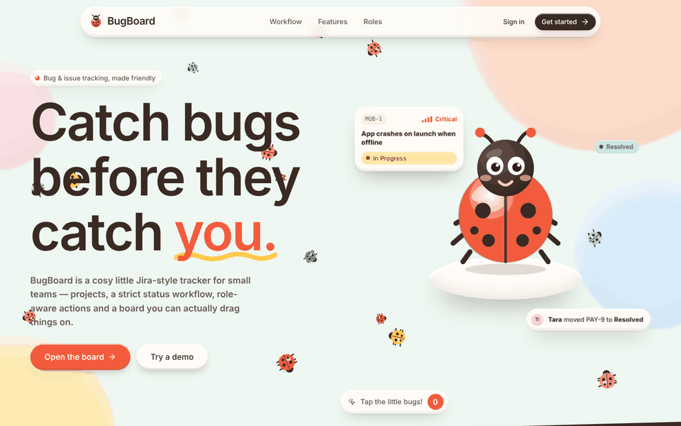

### Demo

**Drag-and-drop board** — columns a role can't drop into fade out; the server re-checks every move.

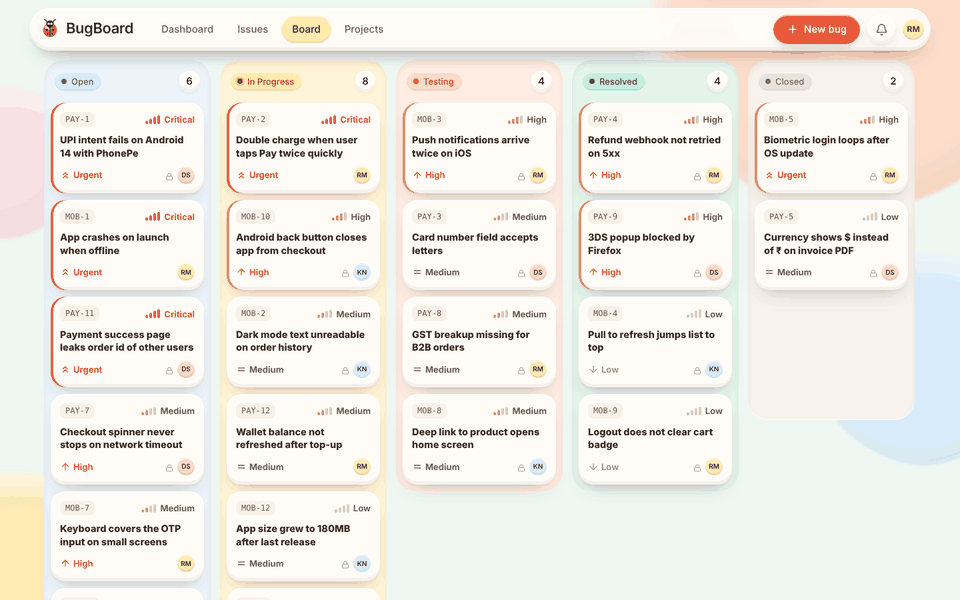

### Screenshots

| Dashboard | Issues (table + filters) |
| --- | --- |
| 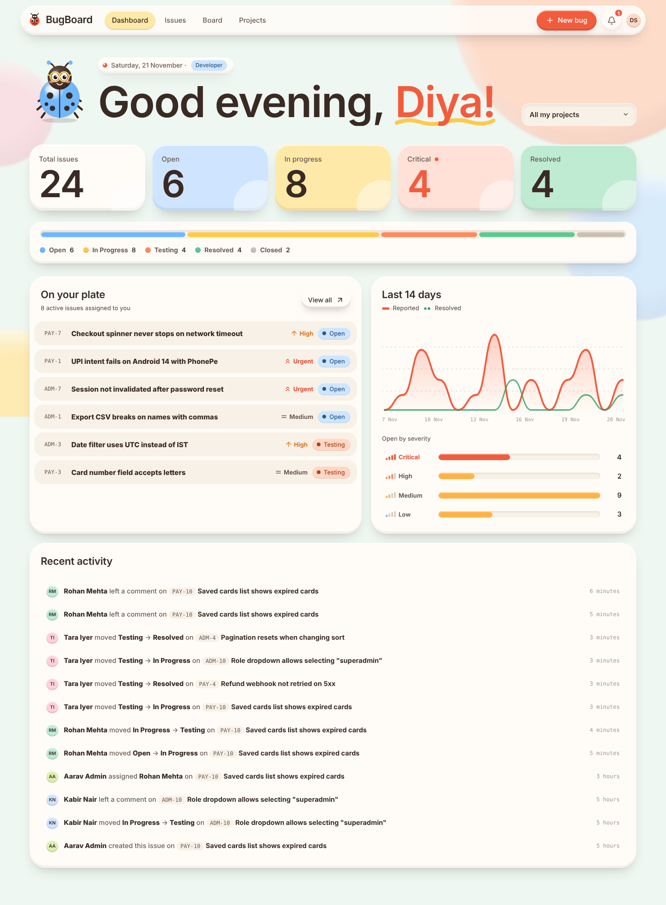 | 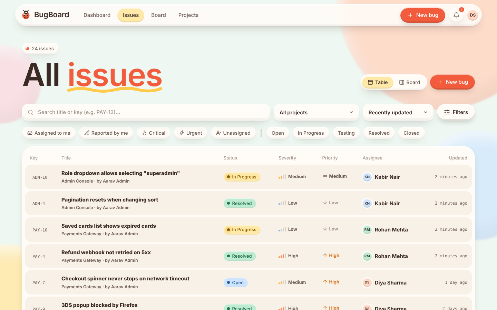 |
| **Kanban board** | **Issue detail — workflow, comments, history** |
| 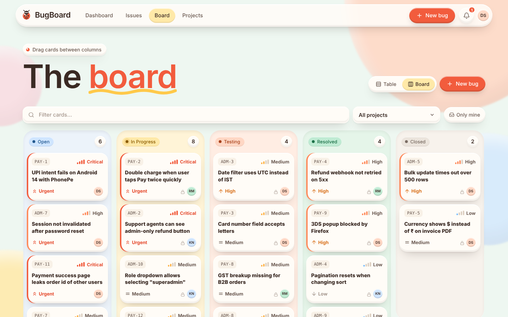 | 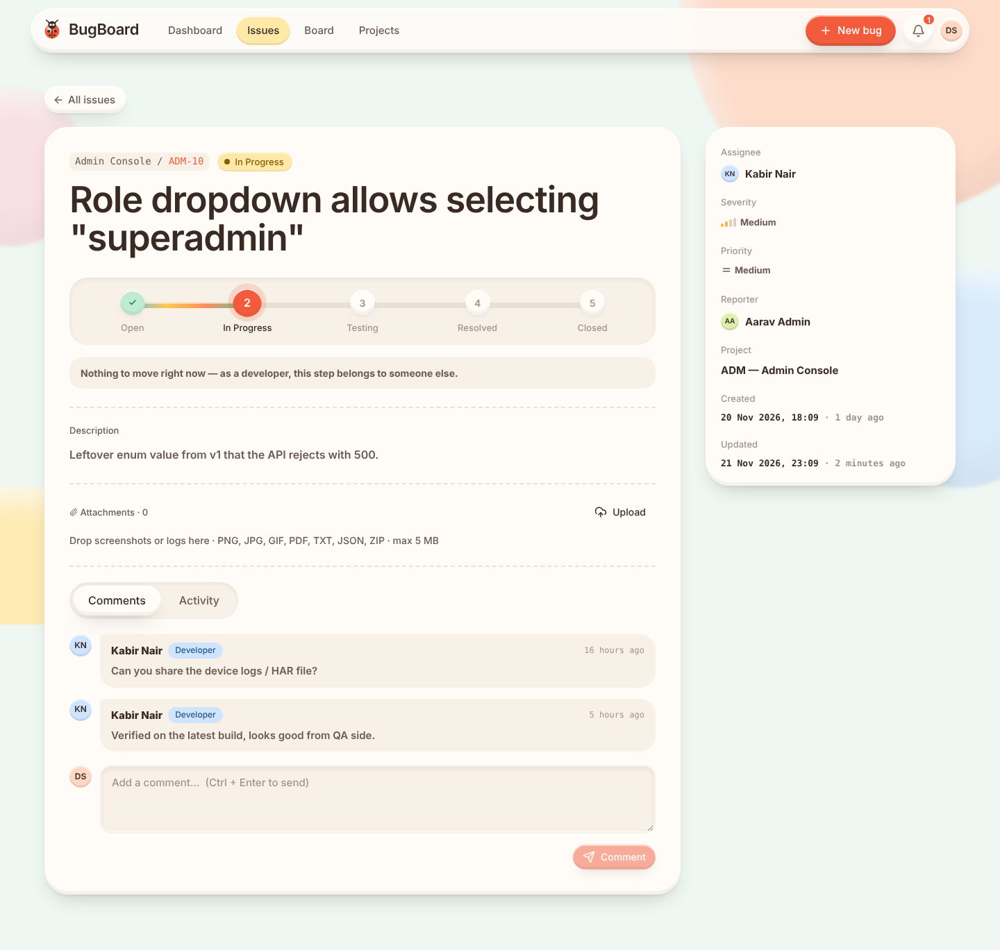 |
| **Report a bug** | **Projects (admin)** |
| 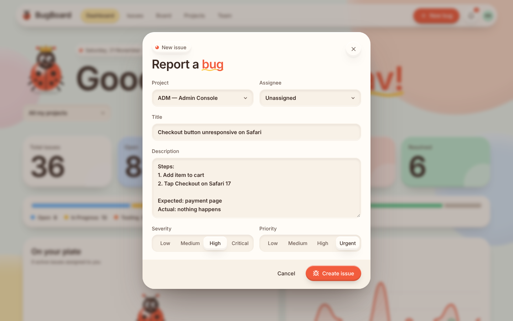 | 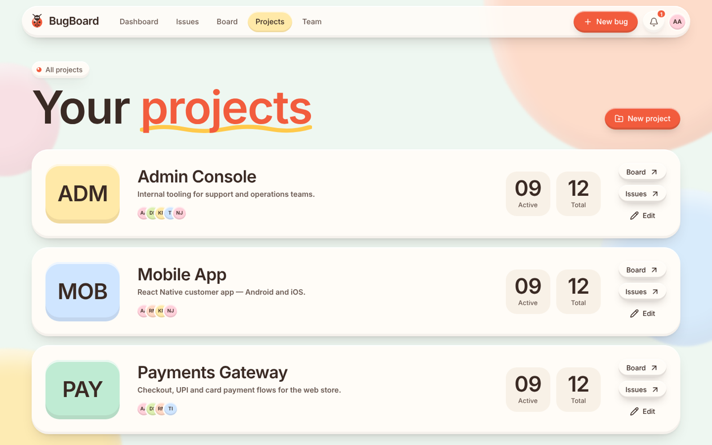 |
| **In-app notifications** | **Login with demo accounts** |
| 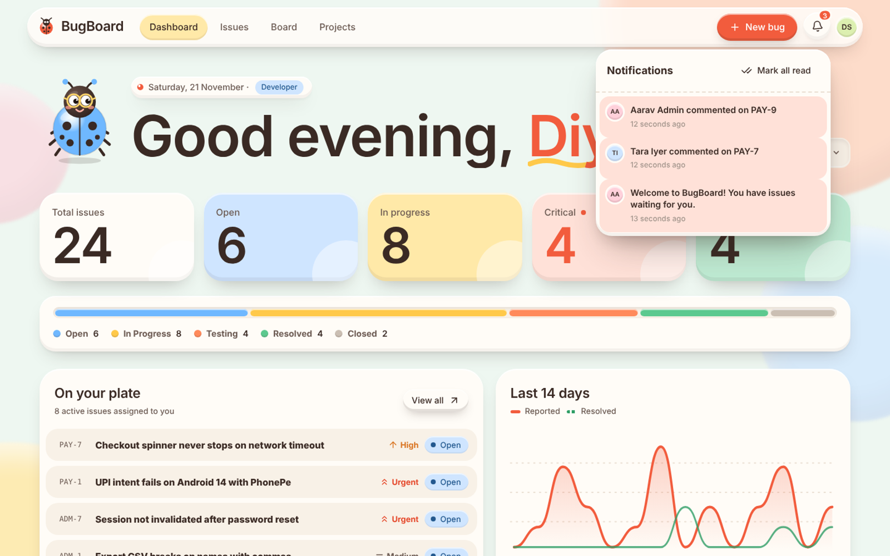 | 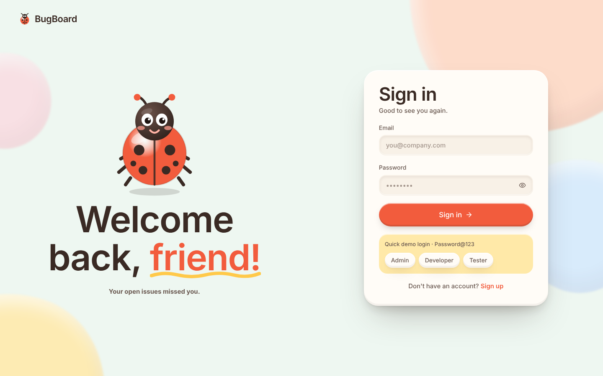 |
| **Roles** | **Static landing** |
| 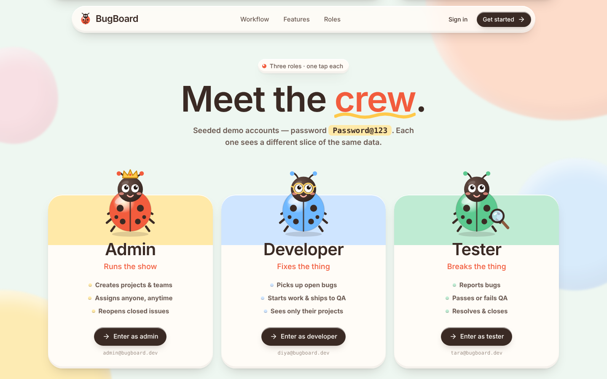 | 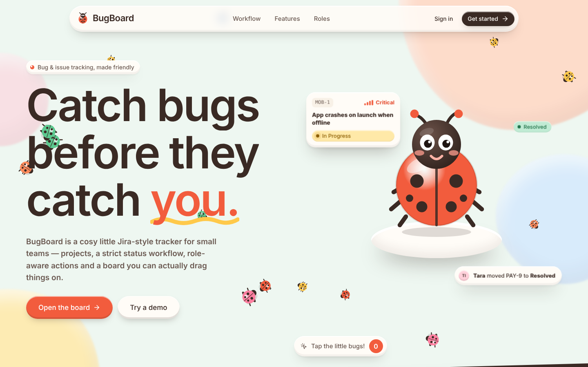 |

**Mobile**

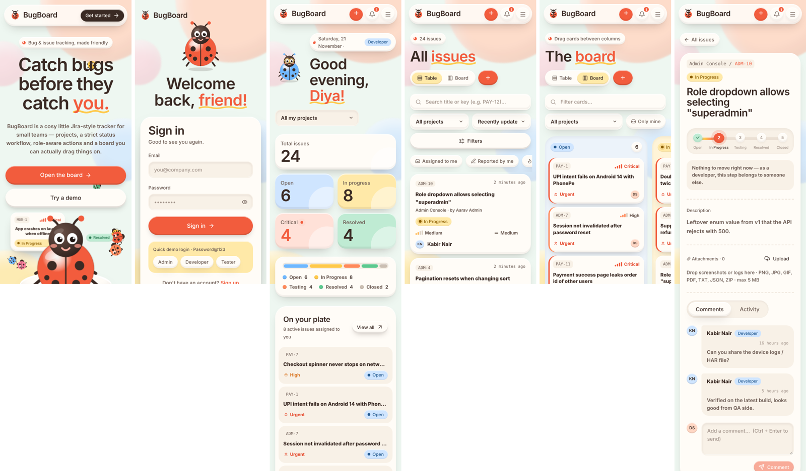

---

## Contents

1. [Features](#features)
2. [Tech stack](#tech-stack)
3. [Getting started](#getting-started)
4. [Environment variables](#environment-variables)
5. [Demo accounts](#demo-accounts)
6. [Roles & permissions](#roles--permissions)
7. [Status workflow](#status-workflow)
8. [API reference](#api-reference)
9. [Data model & indexing](#data-model--indexing)
10. [Project structure](#project-structure)
11. [Tests](#tests)
12. [Docker](#docker)
13. [Design decisions](#design-decisions)
14. [Known limitations](#known-limitations)

---

## Features

**Core requirements**

- **Auth** — register / login with bcrypt-hashed passwords (12 rounds) and JWT. Rate-limited auth endpoints.
- **Roles** — Admin, Developer, Tester. Every rule is enforced in the API; the UI just reflects it.
- **Projects** — name, unique key (e.g. `PAY`), description and members. Admins create/edit; other users only see projects they belong to.
- **Issues** — title, description, project, severity, priority, status, reporter, assignee, created/updated timestamps. Sequential keys per project (`PAY-1`, `PAY-2` …).
- **Workflow** — `Open → In Progress → Testing → Resolved → Closed`, with role checks for each move and rejection of invalid transitions.
- **Search & filters** — project, status (multi-select), priority, severity, reporter, assignee, free-text search — all as API query params, plus sorting and pagination.
- **Comments & activity** — comments with author + time; an activity log for creation, status, assignee, field edits, comments and attachments.
- **Dashboard** — total / open / in progress / critical / resolved counts, issues assigned to me, status pipeline, 14-day created-vs-resolved trend, open-by-severity and a recent activity feed. Every number links to the filtered issue list.
- **Loading, empty and error states** on every data view; fully responsive from 360px phones to wide desktops.

**Bonus features implemented**

- ✅ Kanban board with drag-and-drop status changes (mouse, touch and keyboard). While dragging, columns you are not allowed to drop into are dimmed; the server still re-checks every move and the card rolls back if it is rejected.
- ✅ Screenshot / file attachments (images, PDF, TXT, JSON, ZIP · 5 MB each · max 10 per issue).
- ✅ Activity timeline showing field changes (`from → to`).
- ✅ In-app notifications for assignment, status changes and comments.
- ✅ Pagination and sorting (priority/severity sort by logical rank, not alphabetically).
- ✅ Automated API tests (22 tests, Node's built-in test runner + Supertest).
- ✅ Docker Compose setup (MongoDB + API + nginx-served client).

---

## Tech stack

| Layer | Tech |
| --- | --- |
| Frontend | React 19, Vite, React Router, Framer Motion, dnd-kit, Axios, date-fns, lucide-react, Lenis |
| Backend | Node.js, Express 5, Mongoose, Zod (validation), JWT, bcryptjs, Multer, Helmet, express-rate-limit |
| Database | MongoDB |
| Testing | `node:test`, Supertest, mongodb-memory-server |

The UI uses hand-written CSS (no UI kit) with a design-token system in `client/src/styles/global.css`. The mascot is a pure SVG React component (`client/src/components/Mascot.jsx`).

---

## Getting started

### Prerequisites

- **Node.js 18+** (20 LTS recommended)
- **MongoDB** — a local instance (`mongodb://127.0.0.1:27017`) or a MongoDB Atlas connection string

### 1. Install

```bash
git clone <your-repo-url> bugboard
cd bugboard
npm run install:all          # installs root, server and client dependencies
```

### 2. Configure environment

```bash
cp server/.env.example server/.env    # then edit MONGO_URI / JWT_SECRET
cp client/.env.example client/.env    # optional — defaults work for local dev
```

On Windows (PowerShell) use `copy` instead of `cp`.

### 3. Seed demo data

```bash
npm run seed
```

Creates 6 users (all roles), 3 projects and 36 realistic issues spread across the workflow, with comments and history over the last 14 days. **The seed wipes the BugBoard collections first.**

### 4. Run

```bash
npm run dev
```

- Client → http://localhost:5173
- API → http://localhost:5000/api (health check: `/api/health`)

The Vite dev server proxies `/api` and `/uploads` to the API, so there are no CORS issues in development.

You can also run each part on its own: `npm run dev --prefix server` and `npm run dev --prefix client`.

### Production build

```bash
npm run build                 # outputs client/dist
npm start --prefix server
```

---

## Environment variables

### `server/.env`

| Variable | Required | Default | Description |
| --- | --- | --- | --- |
| `MONGO_URI` | ✅ | — | MongoDB connection string |
| `JWT_SECRET` | ✅ | — | Secret used to sign JWTs — use a long random string |
| `JWT_EXPIRES_IN` | | `7d` | Token lifetime |
| `PORT` | | `5000` | API port |
| `CLIENT_URL` | | `http://localhost:5173` | Allowed CORS origin(s), comma separated |
| `MAX_UPLOAD_MB` | | `5` | Max attachment size |
| `NODE_ENV` | | `development` | `production` hides internal error messages |

The server refuses to start if a required variable is missing.

### `client/.env`

| Variable | Default | Description |
| --- | --- | --- |
| `VITE_API_URL` | `/api` | API base URL (keep `/api` when using the dev proxy) |
| `VITE_PROXY_TARGET` | `http://localhost:5000` | Where the Vite dev proxy forwards requests |

`.env` files are git-ignored — only the `.env.example` files are committed.

---

## Demo accounts

All demo accounts use the password **`Password@123`** (created by `npm run seed`).

| Role | Email | Projects |
| --- | --- | --- |
| Admin | `admin@bugboard.dev` | all |
| Developer | `diya@bugboard.dev` | PAY, ADM |
| Developer | `rohan@bugboard.dev` | PAY, MOB |
| Developer | `kabir@bugboard.dev` | MOB, ADM |
| Tester | `tara@bugboard.dev` | PAY, ADM |
| Tester | `neel@bugboard.dev` | MOB, ADM |

The landing page and the login screen have one-click buttons for the demo roles.

---

## Roles & permissions

All checks live in the API (`server/src/utils/workflow.js`, `server/src/utils/access.js` and the controllers). The issue endpoint also returns a `permissions` object (`canEdit`, `canAssign`, `transitions`, …) computed by the same functions, so the UI never duplicates the rules.

| Action | Admin | Developer | Tester |
| --- | :-: | :-: | :-: |
| See projects | all | member only | member only |
| Create / edit projects, manage members | ✅ | ❌ | ❌ |
| Change user roles | ✅ | ❌ | ❌ |
| Report an issue (in own projects) | ✅ | ✅ | ✅ |
| Edit title / description / severity / priority | ✅ | reporter only | reporter only |
| Assign / reassign anyone | ✅ | ❌ | ✅ |
| Take an unassigned issue / release own | — | ✅ (Open / In Progress only) | — |
| Delete issue | ✅ | ❌ | ❌ |
| Comment / attach files | ✅ | ✅ | ✅ |

**Rules**

- Public sign-up can only create **Developer** or **Tester** accounts. Admins are created by the seed or promoted by an existing admin.
- **Assignee rule:** an assignee must be a **member of the issue's project** with the **Developer or Admin** role.
- A member can't be removed from a project while they are assigned to an active issue in it (reassign first).
- Closed issues can only be edited or reopened by an admin.
- Projects and issues that a user can't access return **404** (not 403), so their existence isn't revealed.

---

## Status workflow

```
Open ──► In Progress ──► Testing ──► Resolved ──► Closed
  ▲          │  ▲            │          │            │
  └──────────┘  └────────────┘◄─────────┘            │
  (dev gives back) (QA fails)   (reopen)             │
  ▲                                                  │
  └──────────────── admin reopen ────────────────────┘
```

| From → To | Who |
| --- | --- |
| Open → In Progress | assigned developer (a developer starting an **unassigned** issue is auto-assigned) |
| In Progress → Testing | assigned developer |
| In Progress → Open | assigned developer |
| Testing → Resolved | tester |
| Testing → In Progress | tester (QA failed) |
| Resolved → Closed | tester or the reporter |
| Resolved → In Progress | tester or the reporter (regression) |
| Closed → Open | admin only |

Admins may perform any **valid** edge but can't skip steps (and an issue needs an assignee before work can start). Skipping (e.g. Open → Closed) returns **422** with the allowed targets; a valid edge performed by the wrong role returns **403**.

---

## API reference

Base URL: `/api`. All routes except register/login/health require `Authorization: Bearer <token>`.
Responses are JSON: `{ success: true, ... }` or `{ success: false, message, details? }` where `details` is a list of `{ field, message }` validation errors.

| Method | Route | Description |
| --- | --- | --- |
| POST | `/auth/register` | Create account (`name, email, password, role: developer\|tester`) |
| POST | `/auth/login` | Returns `{ token, user }` |
| GET | `/auth/me` | Current user |
| GET | `/users?role=&q=` | List users *(admin)* |
| PATCH | `/users/:id/role` | Change a user's role *(admin)* |
| GET | `/projects` | Projects visible to the user, with issue counts |
| GET | `/projects/:id` | Project + members |
| POST | `/projects` | Create project *(admin)* |
| PATCH | `/projects/:id` | Update name / description / members *(admin)* |
| GET | `/issues` | List with filters (below) |
| POST | `/issues` | Create issue |
| GET | `/issues/:id` | Issue + `permissions` |
| PATCH | `/issues/:id` | Edit title / description / severity / priority |
| PATCH | `/issues/:id/status` | `{ status }` — workflow-checked |
| PATCH | `/issues/:id/assign` | `{ assignee: id \| null }` |
| DELETE | `/issues/:id` | Delete issue + comments + activity + files *(admin)* |
| POST | `/issues/:id/attachments` | `multipart/form-data`, field `files` (max 5 per request) |
| DELETE | `/issues/:id/attachments/:attachmentId` | Uploader or admin |
| GET | `/issues/:id/comments` | Comments (oldest first) |
| POST | `/issues/:id/comments` | `{ body }` |
| DELETE | `/comments/:id` | Author or admin |
| GET | `/issues/:id/activity` | History (newest first) |
| GET | `/dashboard?project=` | Stats, trend, my issues, recent activity |
| GET | `/notifications` | Latest 30 + unread count |
| PATCH | `/notifications/:id/read` · `/notifications/read-all` | Mark read |

**`GET /issues` query params**

| Param | Example | Notes |
| --- | --- | --- |
| `project` | `6650…` | must be a project you can access |
| `status` | `open,in_progress` | comma-separated, multi-value |
| `priority` / `severity` | `urgent` / `critical,high` | comma-separated |
| `assignee` | `me`, `none` or a user id | |
| `reporter` | `me` or a user id | |
| `q` | `checkout` or `PAY-12` | case-insensitive match on title and key |
| `sort` | `-updatedAt` (default), `createdAt`, `-priority`, `-severity`, `number` … | |
| `page`, `limit` | `1`, `20` | `limit` ≤ 200 |

Status codes used: `200, 201, 204, 400` (validation), `401` (no/invalid token), `403` (role not allowed), `404` (missing or not visible), `409` (duplicate email/project key), `422` (business rule, e.g. invalid transition or assignee), `429` (rate limit).

---

## Data model & indexing

```
User ──< Project.members >── Project ──< Issue ──< Comment
                                          │
                                          ├──< Activity   (append-only history)
                                          └──< Notification (per recipient)
```

| Collection | Key fields | Indexes & why |
| --- | --- | --- |
| **User** | name, email (unique, lowercase), password (`select: false`), role | `email` unique; `role` for the admin user picker |
| **Project** | name, key (unique, `^[A-Z][A-Z0-9]{1,5}$`), description, members[], createdBy, issueSeq | `key` unique; `members` multikey — "which projects can this user see" runs on almost every request |
| **Issue** | project, number, key, title, description, severity, priority, status, reporter, assignee, attachments[] | `{project, number}` unique; `{project, status, updatedAt}` for the board and filtered lists; `{assignee, status}` for "assigned to me"; `{severity, status}` for critical counts; `reporter`; `key` |
| **Comment** | issue, author, body | `{issue, createdAt}` — thread order |
| **Activity** | issue, project, actor, type, field, from, to | `{issue, createdAt}` for the timeline; `{project, createdAt}` for the dashboard feed |
| **Notification** | user, issue, actor, type, message, read | `{user, read, createdAt}`; TTL index removes notifications after 30 days |

Relationship notes:

- **Membership lives on the project** (`members: [UserId]`), so access checks are a single indexed lookup and adding/removing members is one update.
- **Issue keys** come from an atomic `$inc` on `Project.issueSeq`, so two people reporting at the same moment never get the same key. `key` is stored on the issue (denormalised) so lists and search don't need a join.
- **Comments and activity are separate collections** rather than embedded arrays, so an issue document doesn't grow without bound and both can be paginated independently.
- **Attachments are embedded** in the issue — there are few of them (≤ 10) and they are always read with the issue.
- Activity stores **user ids** for assignee changes (so history survives renames); names are resolved in one query when the timeline is read.
- Dashboard counters use a single `$facet` aggregation; project issue counts use one `$group` for all projects (no N+1 queries).

---

## Project structure

```
bugboard/
├── server/
│   ├── src/
│   │   ├── config/        env + db connection
│   │   ├── models/        User, Project, Issue, Comment, Activity, Notification
│   │   ├── middleware/    auth (JWT + roles), zod validation, error handler, uploads
│   │   ├── validators/    zod schemas for every request
│   │   ├── controllers/   route handlers
│   │   ├── routes/        express routers
│   │   ├── utils/         workflow rules, access checks, notifications, ApiError
│   │   ├── seed/          demo data
│   │   ├── app.js         express app (imported by tests)
│   │   └── server.js      entry point
│   ├── tests/             API tests
│   └── uploads/           attachment storage
├── client/
│   └── src/
│       ├── api/           axios instance + error helpers
│       ├── context/       auth context
│       ├── hooks/         useAsync, useDebounce
│       ├── components/    layout, modals, UI primitives, animated bug canvas
│       ├── pages/         Landing, Auth, Dashboard, Issues, Board, IssueDetail, Projects, Team
│       ├── lib/           status/workflow meta, activity formatter
│       └── styles/        design tokens + page styles
├── docker-compose.yml
└── docs/screenshots/
```

---

## Tests

```bash
npm test
```

22 API tests covering registration/login, validation errors, admin-only routes, project visibility for non-members, sequential issue keys, the assignee rule, the full workflow, invalid (422) and forbidden (403) transitions, auto-assignment, edit permissions, developer self-assignment, filters/search/pagination, comments + notifications and dashboard scoping.

Tests use an in-memory MongoDB (`mongodb-memory-server` downloads a MongoDB binary on the first run). To use an existing instance instead:

```bash
MONGO_TEST_URI=mongodb://127.0.0.1:27017/bugboard_test npm test
```

---

## Docker

```bash
docker compose up --build
docker compose exec server node src/seed/seed.js    # load demo data
```

Open http://localhost:8080. nginx serves the built client and proxies `/api` and `/uploads` to the API container. Set `JWT_SECRET` in your shell or a root `.env` before running in any shared environment.

---

## Design decisions

- **Server is the single source of truth for permissions.** `workflow.js` defines each allowed transition together with the roles that may perform it. The same function rejects requests and builds the `permissions.transitions` list the UI renders, so buttons and API can't drift apart. The board keeps a small client-side copy only to dim columns while dragging.
- **422 vs 403.** A move that doesn't exist in the workflow is a business-rule error (422); a valid move by the wrong role is a permission error (403). The response message says which transitions are allowed.
- **Validation with Zod at the edge.** Every body/query/param is parsed before reaching a controller, values are coerced (`page`, `limit`), unknown fields are stripped and errors come back per field — the frontend maps them straight onto form inputs.
- **Filtering via query params + aggregation.** One `$match` built from the params, a computed rank for priority/severity sorting and `$facet` for items + total in one round-trip.
- **Optimistic board updates.** Cards move instantly; if the API rejects the move, the board rolls back and shows the server's reason.
- **Notifications by polling (30s).** It keeps the stack simple without a websocket server and is enough at this scale.
- **UI.** A custom "clay" design system instead of a component library: soft pastel surfaces, puffy layered shadows, Fredoka + Nunito type and a hand-drawn SVG ladybug mascot (Dotty) whose eyes follow the cursor and who changes outfit per role. Motion is spring-based and used for feedback — page transitions, count-ups, the workflow stepper, drag states and the catch-the-bug hero. `prefers-reduced-motion` is respected.

## Known limitations

- Attachments are stored on the local disk (`server/uploads`). In production these should go to object storage (S3/Cloudinary).
- Notifications use polling, not real-time push; there are no email notifications.
- Search uses a case-insensitive regex on title and key. It is fine for this data size; a MongoDB text index or Atlas Search would be better for large datasets.
- JWT is kept in `localStorage` for simplicity. An httpOnly refresh-token cookie would be safer against XSS.
- No password reset / email verification flow.
- The board loads up to 200 issues per view; very large projects would need per-column pagination.
- Project keys can't be changed after creation (existing issue keys depend on them).
